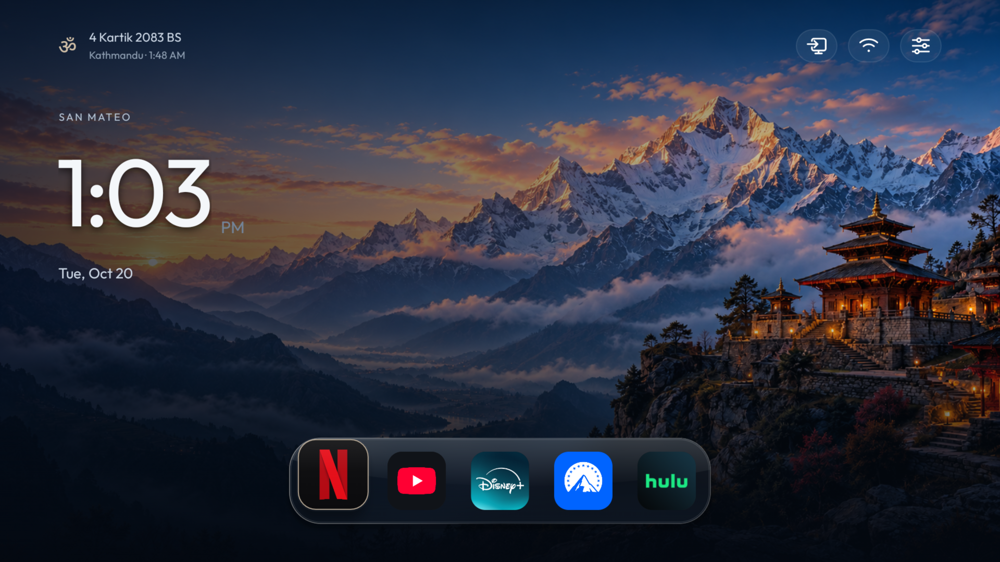
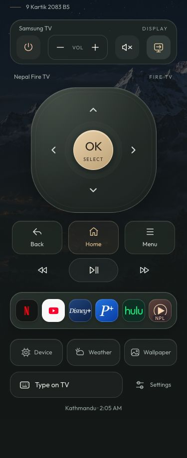
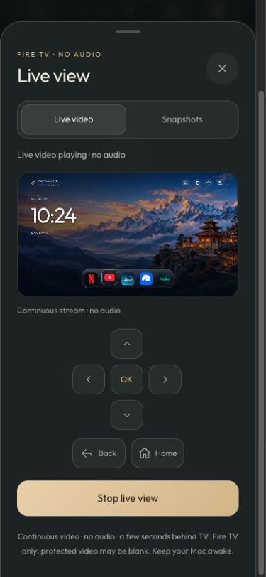
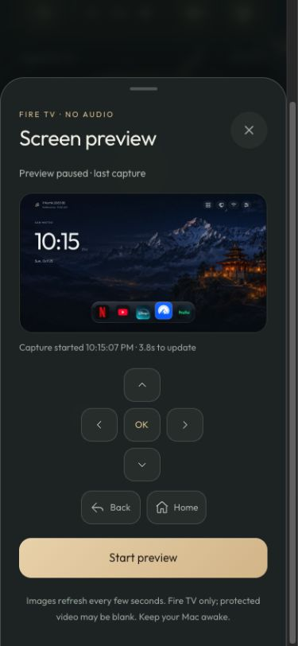

# Nepal TV Home

A calm, dark home screen for Fire TV with Himalayan scenes, an English clock, a small Nepali date and a compact glass dock. Adapted from [Gathin23/tv-vibehack](https://github.com/Gathin23/tv-vibehack).

**Launcher v22 / 4.7.0-wallpapers · Theater 2.2.1 · source preview**

## Features

- Fixed wallpaper colors while browsing, with optional time-of-day scenes plus Annapurna and Pashupati artwork. See [wallpaper artwork](docs/WALLPAPER-ARTWORK.md).
- A frosted dock with rounded tiles, gentle focus lift and compact official Netflix/YouTube marks; other apps use native artwork.
- English San Mateo time/date and a smaller Kathmandu clock and Bikram Sambat civil date.
- Local appearance settings, favorite-app controls and an included clock screensaver.
- **Sources on the TV:** pair a compatible Samsung once, then use the Fire remote to choose from Samsung's input picker. No computer needed.
- On-TV Tools for live Fire TV RAM/storage, current weather and a seven-day forecast, and wallpaper choices.
- AirPlay connection help in TV Home and the phone remote, using a compatible television's built-in receiver.
- An optional phone/web remote with the same tools, a glass D-pad, app dock, Type on TV, Samsung controls, remembered pairing and optional browser haptics.
- An ESPN launch shortcut in remote Settings; install the official app separately.
- An optional [Theater TV app](framextv/README.md) with native movie/show search, season/episode selection, phone title commands and frameXTV's embedded web player. Use **Play on Theater** beside Live view or launch the app from remote Settings.
- Optional **Live view** in the phone remote: continuous video or separate Snapshots, explicit Start/Stop and an in-sheet D-pad; no audio on the tested Fire TV.

Netflix, YouTube, Disney+, Paramount+ and Hulu are the default favorites. Install the apps separately; subscriptions are not included.

## Phone remote

The redesigned companion uses a warm Himalayan theme, a floating app dock and matching sheets for typing, Samsung Sources and pairing. Device readings refresh every ten seconds while open. Weather shows current conditions, daily highs/lows and a seven-day forecast. Wallpaper applies Automatic, Morning, Dusk, Night, Annapurna or Pashupati through a protected fixed command. The two new scenes require launcher v22; existing modes work with v19+. AirPlay opens local connection instructions, available before pairing and while the TV connection is offline. It supports keyboard controls, visible focus, reduced motion and narrow phone layouts. Notifications appear inside the active sheet so confirmations and errors stay visible.

Pair with the six-digit PIN printed by the companion. Each installation generates its own code once and saves it privately in `remote/state/pairing-code.json`; updates and restarts reuse it. **Remember this device for 30 days** is checked by default: the same browser at the same remote URL can reconnect after an eight-hour session expires or the companion restarts without re-entering the code. Uncheck it on shared devices, or use **Settings → Forget this device** to revoke saved trust. Keep private state when updating, and exclude it from Git and release archives. See [remembered-browser setup and limits](remote/README.md#remember-this-browser).

Optional [fast key input](remote/README.md#optional-fast-key-input) uses the explicitly installed, pinned scrcpy 5.0.1 server to reuse a control connection. It needs neither FFmpeg nor an active Live view. Browser haptics are optional and available only where the phone supports the Vibration API.

*Remote interface. The computer must stay awake while using the phone remote; on-TV Tools run directly on the Fire TV. Native AirPlay streams directly to a compatible television and does not require the companion computer.*

**Live view**, below the remote's Tools row, defaults to **Live video** and starts only after **Start live video**. The Fire TV sends continuous H.264 through the awake companion computer, which supplies an HLS player with navigation controls. Expect several seconds of delay and video without audio on the tested stick. The included local HLS player is preferred where supported, including compatible Safari versions; native HLS is the fallback on browsers such as older iOS Safari. Stop, closing/hiding the page or losing the session clears playback and ends the owned producer. It never resumes automatically. Continuous video needs optional FFmpeg and the pinned official scrcpy server; see [Live view setup and limits](remote/README.md#live-view).

The **Snapshots** mode retains the earlier still-image preview: select **Start preview**, then one capture runs at a time with a three-second wait after each request. Stop retains a labeled paused image; closing or leaving clears it. Snapshots alone needs optional Pillow. Neither mode shows Samsung apps, native AirPlay or other HDMI sources; protected video may be blank.

*Snapshots mode, captured before the continuous-video player was added. This still image is not evidence of live video playback.*

Follow [remote setup](remote/README.md) to configure your own devices and start the local server. NPL TV is an optional sixth dock shortcut. ESPN opens from remote Settings or the launcher’s app drawer after installation. These apps and their subscriptions are not included.

## Compatibility and setup

The tested setup is a **2018 Fire TV Stick 4K, AFTMM/mantis, Fire OS 6.7.1.1 (Android API 25)** with a **Samsung UN65TU7000BXZA** display. Other devices and firmware are unverified. Android minimum SDK 25 alone is not a compatibility guarantee.

Start with [manual build and setup](docs/SETUP.md). You need JDK 17, Android SDK 34 and Android platform-tools. This source preview has no automatic installer or guaranteed release APK.

Installing the app **does not root, debloat or automatically fix the physical Home button**. The tested owner's native Home changes were separate, device-specific work. No root payload, stock-Home disabling or system-removal workflow is included.

Clock locations currently default to San Mateo and Kathmandu in source. On-TV weather defaults to San Mateo’s city center in Fahrenheit; its location is currently edited in source. The companion’s optional weather location is configurable and disabled in the public example. A first-run location wizard is not built. The offline civil calendar ends at BS 2083, then falls back to Gregorian; it is not a panchang. Samsung Sources opens the real picker, without claiming the selected HDMI port through API readback.

## Known issues

- Theater 2.2.1's latest API-25 checks opened the correct movie players from phone requests, woke Fire TV, and observed no new native crashes, including empty/loading-result regressions. Continuous playback stalled in recent Inception and The Matrix checks; reliable provider playback remains unresolved. A loaded player or sent command does not confirm a playable stream.
- Live view is video-only on the tested Fire TV, adds several seconds of delay and may show blank protected content. iPhone Safari does not provide the general browser Vibration API, so haptics are unavailable there.

## Security

The public source contains no shared TV authorization. Keep your private setup out of Git, use a maintained Python and the pinned requirements, and keep the remote on a trusted LAN. See [security boundaries and reporting](SECURITY.md) and the [review record](docs/SECURITY-REVIEW.md).

Remembered-browser credentials use an HttpOnly, SameSite Strict cookie with an absolute thirty-day expiry. The companion stores only hashes and expiry times in ignored `remote/state/trusted-devices.json`; never include private state in release archives. Remembering a browser does not expose unauthenticated TV controls or extend an access token's eight-hour lifetime.

## Project notes

- [On-TV Device, Weather and Wallpaper tools](launcher/HOME-TOOLS.md)
- [Native television AirPlay setup and verification](launcher/AIRPLAY.md)
- [Protected remote wallpaper command](launcher/REMOTE-WALLPAPER.md)
- [Samsung Sources and pairing](launcher/NATIVE-SOURCES.md)
- [Glass rendering and verification](launcher/GLASS-DOCK.md)
- [Official compact icon provenance](launcher/BRAND-ICONS.md)
- [Optional webpage remote](remote/README.md)

Code retains the upstream [MIT license](LICENSE). Fonts, calendar data, dependencies and official brand artwork have their own notices in [THIRD_PARTY.md](THIRD_PARTY.md); the project license does not relicense Netflix or YouTube marks. The Himalayan/temple scenes are fictional generated composites. No brand affiliation is implied.
